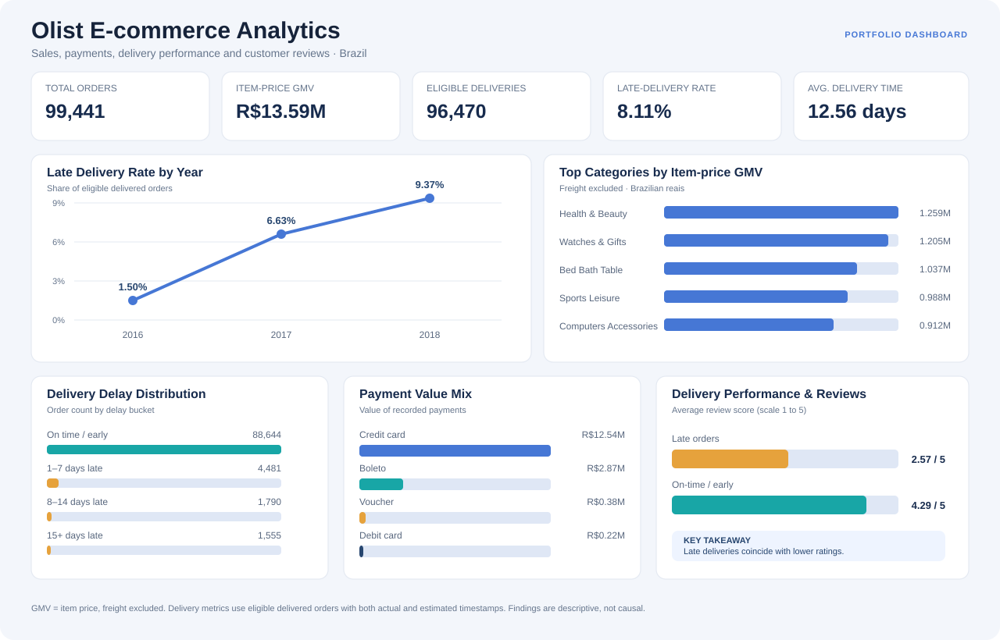

# Olist E-commerce Analytics Portfolio

An end-to-end e-commerce analytics project using the Brazilian E-Commerce Public Dataset by Olist. The project demonstrates SQL data validation, Python/Pandas analysis, an interactive dashboard, and evidence-based business recommendations.

**Tools:** MySQL · SQL · Python · Pandas · Plotly · GitHub

**[Open the interactive dashboard](https://htmlpreview.github.io/?https://github.com/Zaheermuhammadasad/olist-ecommerce-analytics/blob/main/dashboard/olist_recruiter_dashboard.html)** · **[View business insights](analysis/business_insights.md)** · **[Read setup instructions](documentation/getting_started.md)**

## Project overview

The analysis explores sales performance, product categories, customers, payment methods, delivery reliability, and customer reviews. It connects data preparation and analysis to practical operational and commercial questions.

### Business questions

- How do order volumes and item-price GMV vary over time?
- Which product categories contribute the most item-price GMV?
- What payment methods are used most often and account for the highest payment value?
- How does delivery performance vary by year and customer state?
- How are delivery delays associated with customer review scores?
- What data-quality checks are necessary before drawing conclusions?

## Key findings

| Metric / finding | Result |
|---|---:|
| Orders | 99,441 |
| Order-item records | 112,650 |
| Item-price GMV, excluding freight | Approximately R$13.592 million |
| Eligible delivered orders in delivery analysis | 96,470 |
| Late deliveries among eligible orders | 7,826 |
| Late-delivery rate | 8.11% |
| Average purchase-to-delivery time | 12.56 days |
| Late-delivery rate in 2016 | 1.50% |
| Late-delivery rate in 2017 | 6.63% |
| Late-delivery rate in 2018 | 9.37% |
| Average review score: late orders | 2.567 / 5 |
| Average review score: on-time / early orders | 4.294 / 5 |

**Interpretation:** Late-delivery rates increased across the observed years, and late orders had lower average review scores. These are descriptive associations; they do not, by themselves, establish why delays increased or prove that delays alone caused lower ratings.

Other findings include high item-price GMV in Health & Beauty and Watches & Gifts, and substantial geographic variation in delivery risk by customer state. See the business-insights document for evidence, recommendations, and caveats.

## Interactive dashboard

The repository includes a browser-based Plotly dashboard with KPI cards and interactive charts for late-delivery rate by year, top product categories, payment value mix, delay distribution, and review score by delivery performance.

**[Launch the dashboard preview](https://htmlpreview.github.io/?https://github.com/Zaheermuhammadasad/olist-ecommerce-analytics/blob/main/dashboard/olist_recruiter_dashboard.html)**

The preview uses a third-party HTML preview service and loads Plotly from a CDN. The dashboard source is available in dashboard/olist_recruiter_dashboard.html. This is a web dashboard, not a native Power BI PBIX or Tableau TWB report.

## Repository structure

- **sql/** — SQL scripts for data-quality checks, sales, customer, delivery, payments, and reviews.
- **python/olist_analysis.py** — reproducible Pandas workflow.
- **python/requirements.txt** — Python dependencies.
- **analysis/business_insights.md** — findings, evidence, business implications, and recommendations.
- **documentation/data_dictionary.md** — table grains, relationships, KPI definitions, and caveats.
- **documentation/getting_started.md** — setup and execution instructions.
- **documentation/cv_linkedin_project_entry.md** — copy-ready CV and LinkedIn project descriptions.
- **dashboard/** — interactive dashboard HTML, visual preview, and KPI specification.

## Run the Python analysis

1. Install Python 3.10 or later.
2. Download the [Brazilian E-Commerce Public Dataset by Olist](https://www.kaggle.com/datasets/olistbr/brazilian-ecommerce).
3. Place the required CSV files in **python/data/** using their original filenames.
4. Install dependencies and run the script:

   **pip install -r python/requirements.txt**

   **python python/olist_analysis.py**

5. Review the generated files in **python/outputs/**.

See documentation/getting_started.md for the detailed workflow and MySQL import guidance. The raw data is not stored in this repository; download it from the dataset source and follow the setup guide.

## Data definitions and quality notes

- **GMV** here means the sum of item prices; freight is excluded. It is not profit or contribution margin.
- Delivery analysis includes orders marked delivered that have both actual and estimated delivery timestamps.
- Eight records marked delivered lack an actual delivery timestamp and are excluded from the strict delivery-performance denominator.
- An order is late only when its actual delivery timestamp is strictly later than the estimated timestamp.
- Reviews are aggregated to the order level before comparing them with delivery performance.
- State comparisons should include order volume and use a minimum-volume threshold.
- The dataset is historical and observational; results should not be treated as causal evidence.

## Skills demonstrated

SQL querying and joins · Data-quality validation · KPI definition · Python/Pandas data wrangling · Exploratory analysis · Visual communication · Business interpretation · Reproducible documentation

## Contact / portfolio

This project is intended as a practical portfolio example for Data Analyst, Business Analyst, E-commerce Analyst, and Marketing Analytics applications. See the owner's GitHub profile for related work.